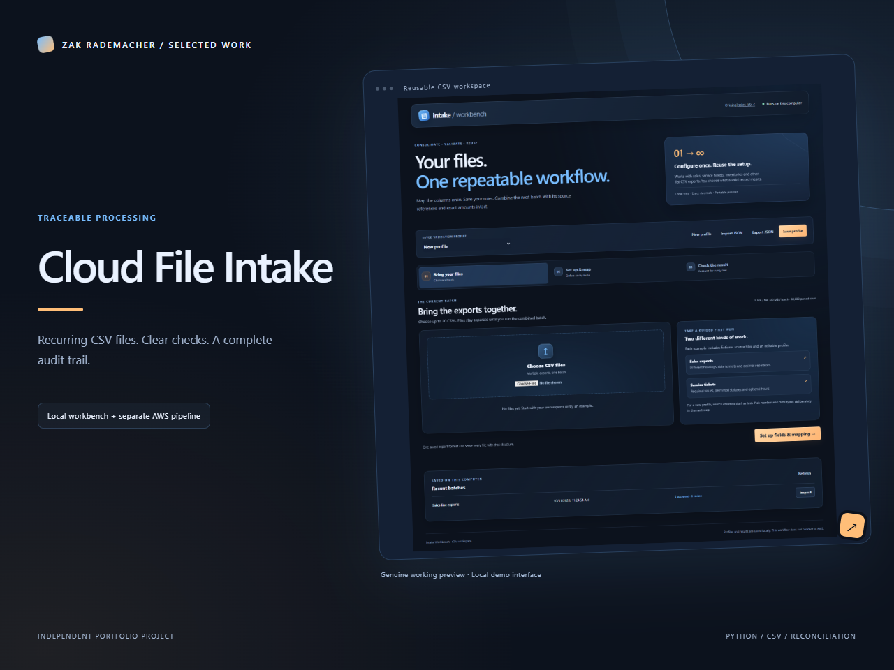
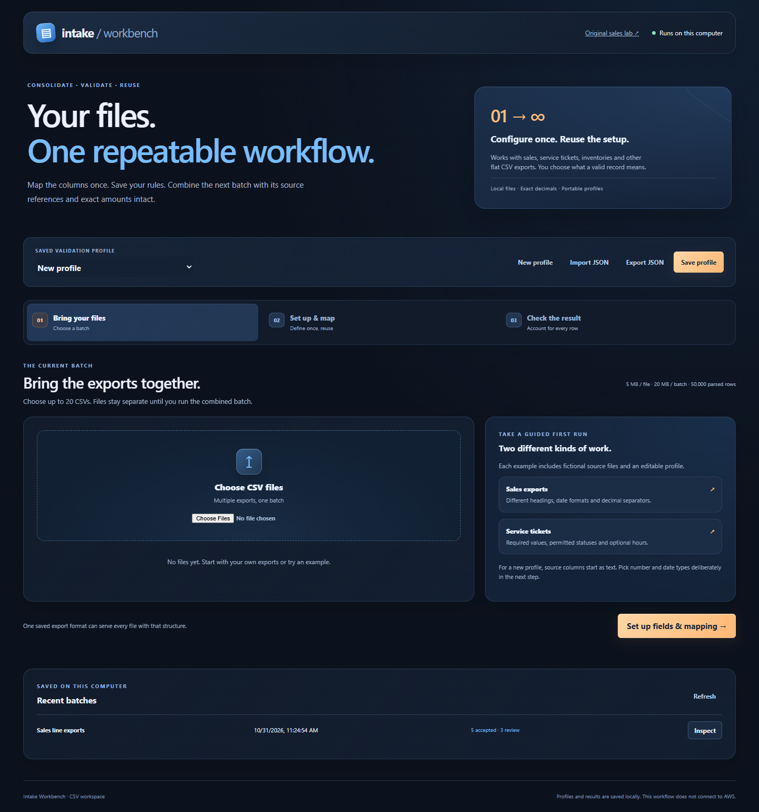
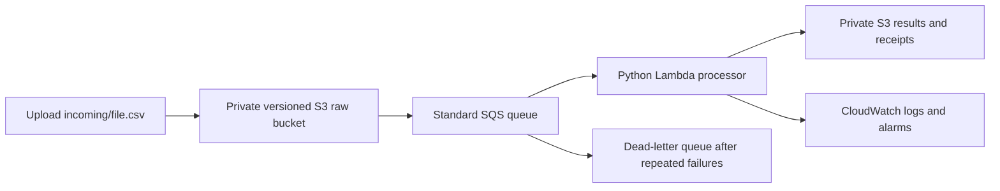

# Cloud File Intake

Turn recurring CSV exports into checked records, a correction queue and a reproducible result. Saved local profiles support reusable consolidation and validation; a separate small AWS pipeline demonstrates reliable cloud ingestion.



**Deployed and core-verified on AWS, October 29, 2026.** A fictional CSV upload passed through S3, SQS and Lambda to produce the expected output files. Live checks also verified replay, schema quarantine, exact source-version handling and native retry/dead-letter/redrive recovery. The browser lab remains local and runs the same Python rules. [See the recorded live checks](docs/LIVE_VERIFICATION.md).

[](https://github.com/ZakJRademacher/cloud-file-intake/actions/workflows/checks.yml)

These are independent demonstrations with separate local-workbench and cloud-processing contracts. There is no public cloud upload endpoint. Review the [case study](docs/CASE_STUDY.md), [sample outputs](deliverables/sample-run/manifest.json) or [cost assumptions](evidence/cost-estimate.json).

The October 31 presentation refresh adds a sky-blue and amber workspace, coordinated motion and responsive layouts. Local workflow checks passed separately from the historical AWS evidence. [Presentation maintenance](docs/VISUAL_DESIGN.md) · [New local checks](evidence/visual-refresh-2026-10-31.json) · [Motion preview](deliverables/portfolio-motion.webm).

## Reusable CSV workbench · local

**Configure a task through the setup screen, then reuse its profile.** The workbench combines multiple CSV exports, maps their headings, validates configurable fields, checks keys across the batch and preserves exact decimal line amounts. Required values, dates, numeric bounds, allowed values, composite keys, extra columns and duplicate policies are editable. Profiles save locally and export/import as JSON.

Double-click **Start Workbench.cmd**, or run `python -m src.local_web --port 8803 --workspace --open-browser`. Try the sales and service-ticket examples, or upload your own files. [Workbench guide](docs/WORKBENCH.md) · [External-data verification](evidence/profile-workbench-kaggle.json).

This reusable workflow runs locally. The AWS deployment and original lab below continue to use the recorded sales-v1 contract. The Excel consolidator remains available as its separate native Power Query template.



## Try the original sales lab

On this computer, double-click **Start Local Demo.cmd**. Keep its terminal open; close it or press Ctrl+C when finished. The launcher opens `http://127.0.0.1:8801/` and uses the configured local Python executable. On another machine, install Python 3.12 and run from this folder:

```powershell
python -m src.local_web --open-browser
```

Start with **Messy weekly sales**, run it again to see replay, and try **Bad schema** to inspect quarantine. Download the CSVs and manifest. The browser lab writes only to this project's git-ignored `local-data/`; it does not connect to AWS. All sample data is fictional.

You can also run the processor directly:

```powershell
python -m src.cli data/samples/weekly-sales.csv
python -m src.cli data/samples/weekly-sales.csv
python -m src.cli data/samples/bad-schema.csv
```

The last command deliberately returns exit code 2 for quarantine. A CLI file over 1 MB is refused before copying. The local core and its tests use only Python's standard library.

## What the first version demonstrates

- An explicit CSV contract, text IDs, signed quantities, exact integer-cent arithmetic and source-row references.
- All conflicting copies of an ID go to review. A valid exact repeat is skipped. Known zero quantities/prices are valid.
- Every input data row is accepted, reviewed or skipped exactly once; accepted totals reconcile to the category summary.
- Identical bytes plus the same rule version reuse one content-addressed result. Separate upload receipts retain source identity.
- Outputs publish before the manifest. Failed partial writes can be retried; readers require the final manifest. Existing output hashes are checked before reuse.
- File-contract errors are quarantined with a reason. Operational failures retry through SQS; repeated failures reach the deployed dead-letter queue and can be redriven after repair.

The fixture yields **14 inputs = 6 accepted + 7 review + 1 skipped**, with **2,050 net cents**. [Inspect the actual sample outputs](deliverables/sample-run/manifest.json).

## AWS architecture



`infra/` provisions private, encrypted buckets; source versioning; a restricted S3-to-SQS policy; a narrowly scoped Lambda execution role; partial-batch failure responses; bounded concurrency; logs, alarms and an optional email notification. An account-wide budget threshold is included. **A budget alert is not a spending cap.** The learning deployment exists in us-east-2. Its resources remain private.

## Learn and operate

- [Your first lesson](docs/FIRST_SESSION.md): inspect the data and explain a replay before touching cloud deployment.
- [Data contract](docs/DATA_CONTRACT.md): exact fields, validation and limitations.
- [Architecture and decisions](docs/ARCHITECTURE.md): components, publication boundary and tradeoffs.
- [AWS setup](docs/AWS_SETUP.md): verified developer tools, authentication and remaining checks.
- [Deployment guide](docs/DEPLOYMENT.md): prepare, plan, deploy and verify using the authorized profile.
- [Operations and recovery](docs/RUNBOOK.md): failed messages, replay, corruption, rollback and teardown.
- [Roadmap](docs/ROADMAP.md): local foundation, live AWS verification and automated deployment.

## Verify

```powershell
python -m unittest discover -s tests -v
python -m tools.verify_demo
python tools/build_lambda.py
python tools/smoke_package.py
```

The deployment package includes the pinned Boto3 SDK and its locked dependencies. It is generated in ignored `build/`; dependency staging stays in a temporary directory outside OneDrive. Dependency licenses remain inside the package.

For Terraform 1.17.0 and provider 6.70.0:

```powershell
cd infra
terraform init -backend=false -input=false
terraform fmt -check -recursive
terraform validate
terraform test
```

Terraform test runs use a mocked provider and `command = plan`; they do not deploy. The saved `evidence/` records distinguish these checks from live AWS verification. GitHub Actions checks the code and infrastructure without cloud credentials and does not deploy. Its badge links to actual hosted runs.

## Boundaries

### Original sales-v1 processor and AWS deployment

One job processes one whole CSV, up to 1,000,000 bytes and 5,000 data rows. Business IDs are checked within that file. Different files remain separate jobs; there is no cross-file sales ledger or warehouse yet. Identical logical rows with changed file bytes are different job inputs. The output is cents in an unspecified source currency.

### Reusable local workbench

The configurable workbench checks keys across a multi-file batch: up to 20 files, 5 MB each, 20 MB combined and 50,000 parsed rows. It preserves exact decimal amounts. It does not execute profiles on AWS or maintain an incremental warehouse. See the [workbench guide](docs/WORKBENCH.md) for its complete contract.

### Local access and verification scope

The local consoles are for this computer, bound to loopback with a per-start request token; it is not a public upload service. Do not expose it to the internet. A production intake portal needs authentication, authorization, abuse controls and a stronger operational review. No production availability or throughput commitment is claimed. Live-cloud claims are limited to the recorded checks.

Source and useful evidence live in the OneDrive project library. Local saving does not establish cloud synchronization. Original code and fictional data: [MIT](LICENSE). SDK and tooling retain their own licenses.
