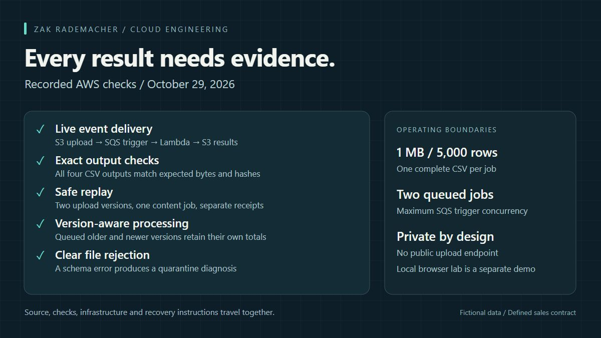
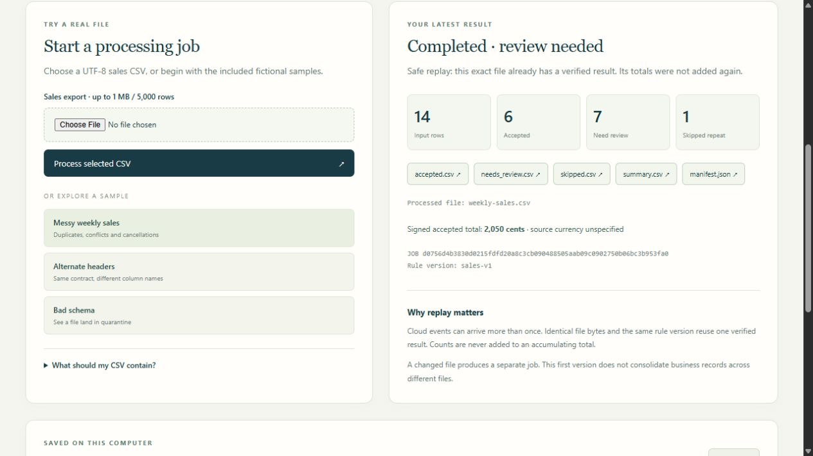

# Cloud File Intake

I used this project to explore what happens after a CSV arrives: checking its format, separating records that need review, and retrying failed work without adding the same result twice.

The configurable [CSV workbench](WORKBENCH.md) runs locally. The AWS workflow below uses the separate, fixed sales-v1 contract.

## The workflow

An authenticated upload lands in a private, versioned S3 bucket. S3 notifies SQS; a Python Lambda reads the notified object version, validates the complete CSV and publishes accepted, review, skipped and summary outputs. A final manifest records row counts, output sizes and hashes. Separate receipts retain the source object/version identity.

Exact repeated bytes reuse the same verified result. Changed bytes create a separate job. This distinction makes repeated delivery safe without claiming cross-file business deduplication.

## Data decisions

The sales contract keeps IDs as text, validates dates, uses integer cents and permits signed quantities. Conflicting copies of an ID all go to review. Known zeros remain valid. A source row is accepted, reviewed or skipped exactly once. Structurally invalid files receive a quarantine diagnosis.

The fictional 14-row example reconciles to 6 accepted, 7 for review and 1 skipped repeat, with 2,050 net cents. The source currency is unspecified. This example is a reconciliation demonstration, not a business outcome for a client.

## Cloud decisions

- Use SQS buffering with bounded retries and a dead-letter queue.
- Read notified S3 versions so overwrites cannot substitute newer source data.
- Write the manifest last; completed results are checked before reuse.
- Block public bucket access, require TLS and scope the function's permissions to its required resources.
- Limit the SQS trigger to two simultaneous jobs, with short log/data retention appropriate to a learning deployment.
- Monitor failed messages separately from Lambda invocation errors; a partial-batch response can report success at invocation level while one message still fails.
- Track costs with a budget notification that excludes credits/refunds. It is not an enforced cap.

## What was actually verified

[Live AWS checks](LIVE_VERIFICATION.md) cover event delivery, sample reconciliation, output hashes, replay, source-version handling and quarantine. The recorded deployment-stage unit tests exercise the processor, storage, adapter, and local HTTP boundaries. Infrastructure has both mocked validation and an authenticated plan.

## Local companion demonstration

The browser lab runs on the user's computer. It demonstrates the same Python core without needing an AWS project and does not connect to the live deployment. The cloud workflow is operated through authenticated AWS tools; it is not a public upload website.

## Boundaries and next steps

One job accepts one complete CSV up to 1,000,000 bytes and 5,000 data rows. There is no cumulative ledger, cross-file record merge, public authentication layer or production service-level objective. A future analytics layer needs an explicit grain, correction policy and cross-file model before adding Parquet, Athena, dbt or dashboards.

Source code, Terraform, fictional fixtures, expected outputs, cost assumptions and recovery instructions are included for review and reproduction.
